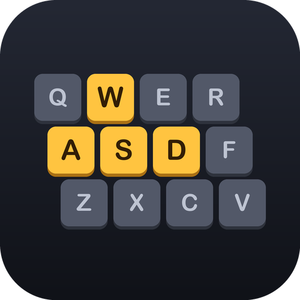
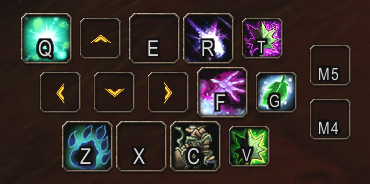

  

<h1 align="center">WASDBars</h1>

<em>Your action bar, shaped like your keyboard.</em>

Have you ever wanted your action bar to be shaped around your actual hotkeys?

Do you struggle to remember what the hell you bound your keys to in the middle of a fight?

Have you ever pressed **F** in a boss fight, only to realise that **F** was Assist Target, and you have never once in your life wanted to assist your target?

**Well, wish no more!** Introducing... **WASD Bars!**

WASD Bars takes your main action bar and puts them in the shape of the keys around your movement keys. Then it binds all your keys around them so you can drag and drop your skills however you like. It's almost as if somebody looked at a keyboard!

- **No more forgetting buttons!** Your ability is where your finger already is.
- **No more rebinding around your movement keys!** Setup binds the keys around WASD for you, in one click, after showing you exactly what it'll change.
- **No more squinting at tiny corner text!** Every button shows its key in big, bold letters. Even from the couch. Not big enough? Make it massive in Edit Mode

Built for a feral druid who got tired of forgetting what each form had its keys bound to. Works for every class, particularly great for classes with stances or forms. Batteries not included. Keyboard sold separately.

*But wait, there's more!*

## What it does

- **The WASD cluster:** action bar 1's twelve buttons move into the shape of Q, E, R, T, F, G, Z, X, C, V and the two mouse side buttons, with W, A, S and D drawn between them as arrow keys.
- **Your buttons:** they are the game's own buttons, so they still change with your form or stance, show cooldowns and range, and you can change them by just dragging and dropping.
- **Action bar 2 takes action bar 1's place:** it sits exactly where action bar 1 was and gets action bar 1's border and button frames as well as key bindings 1–0, - and =.
- **Move and scale it in Edit Mode:** select WASDBars like any other bar, drag it, or change its scale.
- **Large key labels:** each button shows its key in big text at the bottom, or the game's own small corner text if you prefer.

## Setup

On first login WASDBars offers to set up, or type `/wasd setup`. A window will then list every change:

- It creates its own **WASDBars** Edit Mode layout, copied from the one you're using. Your other layouts are never changed so you can revert back anytime you want
- It moves action bar 1's buttons into the cluster, puts action bar 2 in action bar 1's place, hides the gryphons and moves the chat window up to make room.

The buttons are in the cluster only while the WASDBars layout is active. Switch to another layout and they're back on action bar 1.

## Undoing it

Type `/wasd restore` or head on into the addon options and click the shiny red button. You're switched back to your old layout, action bar 1's buttons go back, and you're asked whether to put your keybinds back too. Then delete the WASDBars layout in Edit Mode if you like.

## Commands

- `/wasd setup`: set up the layout and keybinds
- `/wasd restore`: undo setup on this character
- `/wasd options`: open the options
- `/wasd help`: list the commands

## Good to know

- Requires **LibEditMode** and **LibEditModeOverride**; use CurseForge to install them for you.
- The cluster's position and scale are saved per computer, so a second computer starts with the default position.

## Frequently asked questions

**Did you use an LLM to make this? I don't like LLMs?**

I sure did, hand crafted artisanally programmed in a giant auto-complete machine. If that's not your jam, cool, look elsewhere

**But I don't use WASD?**

Okay. Don't install this addon then.

**I use ESDF. Can I have ESDF Bars?**

You can have a GitHub issue. Write a nice one please. Or better yet, fire up claude and send me a Pull Request.

**Will it break my other characters?**

No. A character's bars only move once you've run setup on that character. And a copy of your keybinds is made that you can restore if you don't like it

**Does it change my spells or macros?**

No. They're the game's own buttons with your own spells on them. WASD Bars just moves them into a visible shape

**Why is the chat window moving?**

Because the keys need somewhere to live, and your chat window was standing in the way. If you don't like that, just move things where you like in Edit Mode, including the WASDBar.

**Where did Attack Target go? It used to be on T.**

T is in the cluster now. Setup warned you, in orange, in a list. Attack Target is in Key Bindings, waiting for you to find it a new home.

**What about C for my character sheet?**

Yep I overwrote that one too, pick a new bind or just click the button using your mouse. The world is your oyster.

**Can I make it bigger?**

Yes. Open Edit Mode, select WASDBars and use the Scale slider. Go wild.

**I don't like it. How do I get my old bars back?**

`/wasd restore`. No hard feelings.

## Installing

Install it with the CurseForge app (coming soon), which brings in LibEditMode and LibEditModeOverride for you. Or download the latest zip from [Releases](https://github.com/afoozle/WASDBars/releases/latest) and follow **[INSTALL.md](INSTALL.md)** (Windows and macOS).

## Developing

See **[CONTRIBUTING.md](CONTRIBUTING.md)**.

Found a bug or have an idea? [Open an issue on GitHub](https://github.com/afoozle/WASDBars/issues). I might even do it if I get motivated. Ultimately this addon scratches an itch for me, it might not for you

## License

MIT; see [LICENSE](LICENSE).
